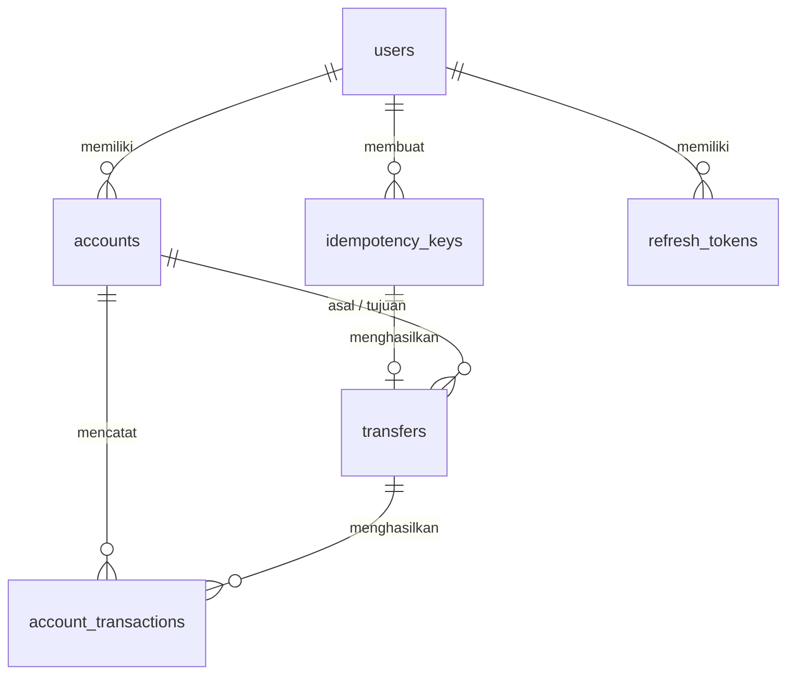

# Transfer Service

RESTful API untuk layanan transfer dana antar-akun (mini project Java Developer). Fokus pada
**reliability, konsistensi data, dan pencegahan transaksi ganda** di lingkungan production.

## Daftar Isi

1. [Tech Stack](#tech-stack)
2. [Cara Menjalankan](#cara-menjalankan)
3. [Arsitektur dan Alasan Pemilihan](#arsitektur-dan-alasan-pemilihan)
4. [Struktur Tabel](#struktur-tabel)
5. [Standar Implementasi](#standar-implementasi)
6. [API](#api)
7. [Error Code](#error-code)
8. [Testing](#testing)
9. [Keterbatasan dan Pengembangan Lanjutan](#keterbatasan-dan-pengembangan-lanjutan)

---

## Tech Stack

| Komponen | Pilihan |
|---|---|
| Bahasa / Framework | Java 21, Spring Boot 3.x |
| Database | PostgreSQL |
| Migration | Flyway |
| Auth | Spring Security + JWT (HS256, jjwt) + refresh token |
| Rate limit | Bucket4j (in-memory) |
| Dokumentasi API | springdoc-openapi (Swagger UI) |
| Test | JUnit 5, Mockito |
| Container | Docker, Docker Compose |

---

## Cara Menjalankan

### Opsi 1: Docker Compose (direkomendasikan)

Prasyarat: Docker dan Docker Compose.

```bash
git clone <repository-url>
cd <nama-folder>
docker compose up --build
```

Aplikasi berjalan di `http://localhost:8080`. Skema database dan data demo dibuat otomatis oleh Flyway
saat aplikasi pertama kali start.

- Swagger UI: http://localhost:8080/swagger-ui.html
- OpenAPI JSON: http://localhost:8080/v3/api-docs

Untuk menghentikan dan menghapus data: `docker compose down -v`.

### Opsi 2: Jalankan lokal

Prasyarat: JDK 21, Maven, dan PostgreSQL (database kosong bernama `transferdb`).

```bash
export DB_URL=jdbc:postgresql://localhost:5432/transferdb
export DB_USER=postgres
export DB_PASSWORD=postgres
export JWT_SECRET=ganti-dengan-secret-minimal-32-karakter
./mvnw spring-boot:run
```

> Migration V2 memakai extension `pgcrypto` (untuk membuat hash BCrypt data demo), yang butuh hak
> superuser saat `CREATE EXTENSION`. Pada image `postgres` resmi di Docker ini sudah terpenuhi.

### Konfigurasi (environment variable)

| Variable | Default | Keterangan |
|---|---|---|
| `DB_URL` | `jdbc:postgresql://localhost:5432/transferdb` | JDBC URL |
| `DB_USER` / `DB_PASSWORD` | `postgres` / `postgres` | Kredensial database |
| `JWT_SECRET` | secret dev | **Wajib diganti di production**, minimal 32 karakter |

Properti lain (masa berlaku token, batas rate limit) ada di `application.properties`.

### Data demo

Password semua user: `password123`

| Username | Nomor rekening | Saldo awal |
|---|---|---|
| `alice` | `1000000001` | 10.000.000,00 |
| `bob` | `1000000002` | 5.000.000,00 |
| `carol` | `1000000003` | 2.500.000,00 |

User baru dari `/register` otomatis mendapat 1 rekening dengan saldo 0.

---

## Arsitektur dan Alasan Pemilihan

### Layered monolith

```
Client
  |
  v
Security Filter Chain:  JwtAuthenticationFilter -> RateLimitFilter
  |
  v
Controller  (validasi request, mapping HTTP)
  |
  v
Service     (aturan bisnis, transaksi)
  |
  v
Repository  (Spring Data JPA)  ->  PostgreSQL (Flyway migration)
```

Untuk lingkup satu domain (auth dan transfer), layered monolith dipilih karena paling sederhana, mudah
diuji, dan seluruh proses transfer dapat berjalan dalam **satu transaksi database**. Memecah menjadi
microservice akan memaksa distributed transaction/saga tanpa manfaat nyata di skala ini.

Struktur package: `config`, `controller`, `dto`, `entity`, `exception`, `repository`, `security`, `service`.

### Alur transfer

Seluruh langkah berikut berjalan dalam satu `@Transactional`:

```
1. Validasi input (akun asal != tujuan, amount, Idempotency-Key)
2. INSERT idempotency key (ON CONFLICT DO NOTHING)
      - sudah ada & payload sama & ada response -> replay response lama
      - sudah ada & payload beda               -> 422
3. Cari id kedua rekening
4. Lock kedua rekening (SELECT ... FOR UPDATE) berurutan berdasarkan id
5. Cek kepemilikan rekening asal dan kecukupan saldo
6. Update saldo, simpan transfer, simpan 2 baris ledger (DEBIT & CREDIT)
7. Simpan response di tabel idempotency, commit
```

### Keputusan desain

| Keputusan | Alasan |
|---|---|
| **Pessimistic locking** (`FOR UPDATE`) | Pada transfer uang, konflik pada akun populer wajar terjadi. Locking menjamin urutan yang pasti dan tidak membutuhkan retry di sisi aplikasi seperti optimistic locking. |
| **Lock berurutan berdasarkan id** | Transfer A->B dan B->A bersamaan akan saling menunggu (deadlock) jika urutan lock berbeda. Dengan urutan id yang konsisten, deadlock tidak mungkin terjadi. |
| **Id rekening dibaca sebagai scalar sebelum lock** | Jika entity dimuat sebelum di-lock, Hibernate bisa memakai saldo lama dari cache sesi. Dengan membaca id saja, saldo selalu dibaca setelah lock didapat. |
| **Tabel idempotency terpisah** | Selain mencegah transaksi ganda lewat `UNIQUE (user_id, idempotency_key)`, tabel ini menyimpan response pertama sehingga request duplikat mendapat hasil yang persis sama. |
| **Idempotency dalam transaksi yang sama dengan transfer** | Jika transfer gagal, baris idempotency ikut rollback sehingga client boleh retry dengan key yang sama. Request paralel dengan key sama menunggu di unique index, bukan lolos bersamaan. |
| **Ledger (`account_transactions`)** | Setiap perubahan saldo (bertambah/berkurang) tercatat lengkap dengan `balance_before` dan `balance_after`, sehingga saldo dapat diaudit dan direkonsiliasi. |
| **`NUMERIC(19,2)` dan `BigDecimal`** | Tidak ada kesalahan pembulatan floating point pada nilai uang. |
| **UUID sebagai primary key** | Tidak dapat ditebak (aman dari enumerasi id) dan tidak bergantung pada sequence database. |
| **Validasi bisnis di Java** | Aturan (saldo cukup, amount positif, dll) berada di satu tempat yang mudah diuji dan menghasilkan pesan error yang jelas. Database hanya menjaga integritas struktural (PK, FK, UNIQUE). |
| **Flyway** | Skema dan data demo versioned dan otomatis terpasang, sehingga lingkungan reviewer identik dengan lingkungan pengembangan. |
| **Access token pendek + refresh token rotasi** | Access token JWT (15 menit) membatasi dampak jika bocor. Refresh token (7 hari) disimpan sebagai hash SHA-256, dirotasi setiap dipakai, dan pemakaian ulang token lama mencabut seluruh sesi user. |

---

## Struktur Tabel



| Tabel | Fungsi | Kolom penting |
|---|---|---|
| `users` | Data login | `username` (unique), `password_hash` (BCrypt) |
| `accounts` | Rekening dan saldo | `account_number` (unique), `balance NUMERIC(19,2)`, `user_id` |
| `idempotency_keys` | Pencegahan transaksi ganda | `UNIQUE (user_id, idempotency_key)`, `request_hash`, `response_status`, `response_body (jsonb)` |
| `transfers` | Satu baris per transfer berhasil | `from_account_id`, `to_account_id`, `amount`, `status`, `idempotency_key_id` (unique) |
| `account_transactions` | Ledger / histori mutasi | `type` (`DEBIT`/`CREDIT`), `category` (`OPENING_BALANCE`/`TRANSFER_OUT`/`TRANSFER_IN`), `amount`, `balance_before`, `balance_after` |
| `refresh_tokens` | Refresh token | `token_hash` (unique, SHA-256), `expires_at`, `revoked_at` |

Satu transfer menghasilkan **2 baris ledger**: `DEBIT` pada rekening pengirim dan `CREDIT` pada rekening
penerima. Saldo awal data demo dicatat sebagai `OPENING_BALANCE` agar histori selalu konsisten dengan saldo.

Script database ada di `src/main/resources/db/migration`:

| File | Isi |
|---|---|
| `V1__create_schema.sql` | Tabel utama dan index |
| `V2__seed_demo_data.sql` | User, rekening, dan opening balance demo |
| `V3__create_refresh_tokens.sql` | Tabel refresh token |

---

## Standar Implementasi

| Kebutuhan | Implementasi |
|---|---|
| **Concurrency management** | `SELECT ... FOR UPDATE` pada kedua rekening, diurutkan berdasarkan id (bebas deadlock), seluruhnya dalam satu transaksi. |
| **Duplicate request protection** | Header `Idempotency-Key` wajib. Unique constraint di database + penyimpanan response untuk replay. Key sama dengan payload berbeda ditolak (422). |
| **Rate limiting** | Bucket4j dalam `OncePerRequestFilter`. Auth: 5 request/menit per IP dan path. Transfer: 10 request/menit per user. Melebihi batas menghasilkan 429 dengan header `Retry-After`. |
| **Exception handling** | `@RestControllerAdvice` dengan format error seragam (`timestamp`, `status`, `code`, `message`). Error 401 dan 403 dari Spring Security memakai format yang sama. |
| **Unit test** | JUnit 5 dan Mockito. Lihat bagian [Testing](#testing). |
| **Containerization** | Dockerfile multi-stage dan `docker-compose.yml` (aplikasi + PostgreSQL). |

Keamanan tambahan: password di-hash BCrypt, pesan login gagal generik dan waktu respons disamakan (anti
user enumeration), rekening asal wajib milik user pada token (403 jika bukan), dan secret JWT dibaca dari
environment variable.

---

## API

Base path: `/api/v1`. Dokumentasi interaktif tersedia di Swagger UI (klik **Authorize**, tempel
`accessToken` dari login).

| Method | Path | Auth | Keterangan |
|---|---|---|---|
| POST | `/auth/register` | - | Daftar user baru (otomatis dibuatkan 1 rekening saldo 0) |
| POST | `/auth/login` | - | Login, mengembalikan access dan refresh token |
| POST | `/auth/refresh` | - | Tukar refresh token dengan pasangan token baru |
| POST | `/transfers` | Bearer JWT | Transfer antar rekening |

### Contoh penggunaan

**1. Login**

```bash
curl -s -X POST http://localhost:8080/api/v1/auth/login \
  -H "Content-Type: application/json" \
  -d '{"username":"alice","password":"password123"}'
```

```json
{
  "accessToken": "eyJhbGciOi...",
  "refreshToken": "q3Z0...",
  "tokenType": "Bearer",
  "expiresIn": 900
}
```

**2. Transfer**

```bash
curl -s -X POST http://localhost:8080/api/v1/transfers \
  -H "Authorization: Bearer <accessToken>" \
  -H "Idempotency-Key: 7f9c1c6e-0001" \
  -H "Content-Type: application/json" \
  -d '{
        "fromAccountNumber": "1000000001",
        "toAccountNumber": "1000000002",
        "amount": 250000.00,
        "note": "Bayar makan"
      }'
```

```json
{
  "transferId": "0b1f2e3c-....",
  "status": "SUCCESS",
  "fromAccountNumber": "1000000001",
  "toAccountNumber": "1000000002",
  "amount": 250000.00,
  "note": "Bayar makan",
  "senderBalanceAfter": 9750000.00,
  "createdAt": "2026-11-02T03:15:30.123Z"
}
```

**3. Kirim ulang request yang sama** (`Idempotency-Key` sama, body sama): mengembalikan response yang sama
persis dengan header `Idempotent-Replayed: true`, dan saldo tidak berubah lagi. Jika body berbeda dengan key
yang sama, hasilnya `422 IDEMPOTENCY_KEY_REUSED`.

**4. Refresh token**

```bash
curl -s -X POST http://localhost:8080/api/v1/auth/refresh \
  -H "Content-Type: application/json" \
  -d '{"refreshToken":"<refreshToken>"}'
```

Refresh token bersifat sekali pakai: token lama langsung dicabut dan diganti yang baru.


Cakupan utama:

- Transfer berhasil (saldo kedua rekening dan 2 baris ledger benar)
- Saldo tidak mencukupi
- Rekening asal sama dengan tujuan dan rekening bukan milik user
- Replay idempotent (key sama, payload sama) dan key sama dengan payload berbeda
- Concurrent: banyak thread melakukan transfer bersamaan, total saldo harus tetap konsisten dan tidak ada saldo negatif
- Auth: login berhasil/gagal, refresh token (rotasi dan deteksi pemakaian ulang)

---

## Keterbatasan dan Pengembangan Lanjutan

- **Rate limit per instance.** Bucket disimpan in-memory sehingga batas berlaku per instance. Untuk
  multi-instance, ganti ke `bucket4j_jdk17-postgresql` atau Redis tanpa mengubah logika filter.
- **IP klien.** Rate limit auth memakai alamat remote langsung dan tidak mempercayai `X-Forwarded-For`.
  Jika di belakang reverse proxy, konfigurasi header forwarding perlu diatur agar IP klien benar.
- **Satu mata uang.** Belum ada konversi atau kolom currency.
- **Belum ada endpoint histori mutasi.** Data ledger sudah tersedia di `account_transactions`;
  `GET /accounts/{id}/transactions` dapat ditambahkan di atasnya.
- **Pembersihan data.** Baris `idempotency_keys` lama dan refresh token kedaluwarsa dapat dibersihkan
  dengan job terjadwal.
- **Observability.** Belum ada metrics dan audit log terstruktur.